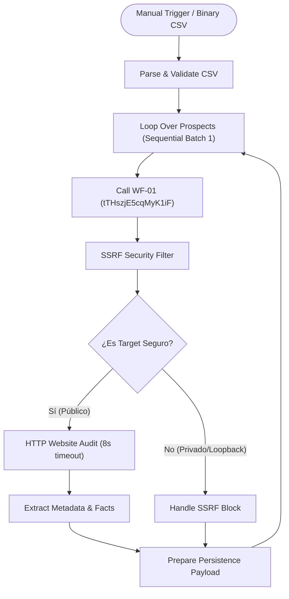

# Arquitectura ZYRVAE WF-02 — CSV Lead Import & Website Audit

## 1. Resumen Ejecutivo y Objetivo
El workflow **ZYRVAE WF-02** automatiza la ingesta masiva de prospectos a partir de archivos CSV, orquesta la validación y deduplicación a través de **ZYRVAE WF-01**, ejecuta auditorías HTTP no invasivas sobre los sitios web de los leads válidos y estructura las evidencias técnicas objetivas para detectar hipótesis comerciales concretas.

* **Estado de activación:** `active: false` (Inactivo según requerimiento).
* **ID de Integración con WF-01:** `tTHszjE5cqMyK1iF` (`ZYRVAE WF-01 Lead Intake & Data Quality`).
* **Tabla de persistencia propuesta:** `website_audits` (relacionada 1:N con la tabla existente `prospects` mediante `prospect_id`).

---

## 2. Diagrama de Flujo del Workflow

---

## 3. Especificación de Nodos

| Nodo | Tipo de Nodo | Propósito y Configuración Clave |
| :--- | :--- | :--- |
| **Manual Trigger** | `n8n-nodes-base.manualTrigger` | Inicio manual / testeo controlado en n8n UI. |
| **Parse & Validate CSV** | `n8n-nodes-base.code` | Soporte para entrada binaria o texto; validación de encabezados; rechazo de filas vacías; validación sintáctica de URL; deduplicación intra-archivo. |
| **Loop Over Prospects** | `n8n-nodes-base.splitInBatches` | Tamaño de lote 1 (`batchSize: 1`) para garantizar procesamiento secuencial estricto y evitar condiciones de carrera (*race conditions*) en deduplicación. |
| **Call WF-01** | `n8n-nodes-base.executeWorkflow` | Invoca a `ZYRVAE WF-01` (`tTHszjE5cqMyK1iF`) delegando normalización y deduplicación en la base de datos principal (`prospects`). |
| **SSRF Security Filter** | `n8n-nodes-base.code` | Evalúa la URL contra rangos RFC 1918 (`10.0.0.0/8`, `172.16.0.0/12`, `192.168.0.0/16`), loopback (`127.0.0.0/8`), link-local/cloud metadata (`169.254.0.0/16`) y protocolos inseguros (`file:`, `ftp:`). |
| **Is Target Safe?** | `n8n-nodes-base.if` | Bifurcación condicional según el resultado del filtro SSRF. |
| **HTTP Website Audit** | `n8n-nodes-base.httpRequest` | Petición `GET` no invasiva. Timeout 8.000 ms, máx. 5 redirecciones, headers estándar con User-Agent corporativo, `neverError: true` para captura controlada de errores 4xx/5xx. |
| **Extract Metadata & Facts** | `n8n-nodes-base.code` | Extracción regex segura de `<title>`, `<meta name="description">`, `<meta name="viewport">`, verificación HTTPS y derivación de hipótesis comerciales objetivas vinculadas al `prospect_id`. |
| **Handle SSRF Block** | `n8n-nodes-base.code` | Registro seguro de evidencia de bloqueo por SSRF sin emitir llamadas de red. |
| **Prepare Persistence Payload** | `n8n-nodes-base.code` | Mapeo al esquema estandarizado de `website_audits`. |

---

## 4. Estructura de Datos y Modelo de Tablas

### Tabla `website_audits`
Definida en [`sql/002_create_website_audits_table.sql`](file:///home/runner/work/my-project-4/my-project-4/sql/002_create_website_audits_table.sql):
* `id` (VARCHAR 36, PK).
* `prospect_id` (VARCHAR 36, FK -> `prospects.id`).
* `audit_date` (TIMESTAMP WITH TIME ZONE).
* `initial_url` (TEXT).
* `final_url` (TEXT).
* `http_status` (INTEGER).
* `redirect_count` (INTEGER).
* `response_time_ms` (INTEGER).
* `page_title` (TEXT).
* `meta_description` (TEXT).
* `has_viewport` (BOOLEAN).
* `ssl_active` (BOOLEAN).
* `is_accessible` (BOOLEAN).
* `error_code` (VARCHAR 100).
* `raw_evidence` (JSONB).
* `commercial_hypotheses` (JSONB).

---

## 5. Pruebas y Evidencias de Verificación
La suite de pruebas automatizadas en [`tests/test_wf02_pipeline.py`](file:///home/runner/work/my-project-4/my-project-4/tests/test_wf02_pipeline.py) ejecutó los siguientes casos sintéticos:

1. **TEST-01 (URL Válida):** `https://example.com` -> 200 OK, SSL detectado, título extraído, hipótesis de falta de viewport generada.
2. **TEST-02 (Error HTTP):** `https://httpbin.org/status/404` -> Captura de código 404, `is_accessible: false`, el prospecto **no es eliminado**.
3. **TEST-03 (URL Sintácticamente Inválida):** `not-a-valid-domain` -> Capturado y registrado en log de errores de parsing.
4. **TEST-04 (Duplicado Intra-Lote):** URL repetida en el mismo CSV -> Detectado y omitido sin duplicación.
5. **TEST-05 (Intento SSRF):** `http://127.0.0.1:8080/admin` -> Bloqueado inmediatamente por el guard SSRF sin llamada de red.
6. **TEST-06 (Fila Vacía):** Fila sin campos -> Descartada y registrada como `EMPTY_ROW`.
