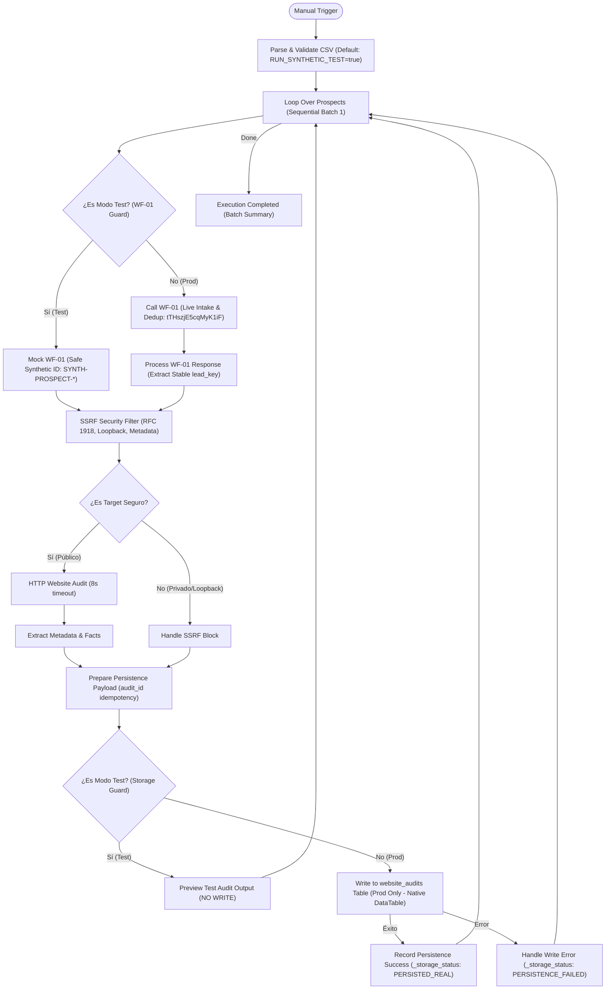

# Arquitectura ZYRVAE WF-02 — CSV Lead Import & Website Audit

## 1. Resumen Ejecutivo y Objetivo
El workflow **ZYRVAE WF-02** (`KosNnbUlKPeKZXHh`) automatiza la ingesta de prospectos mediante CSV, orquesta la validación y deduplicación a través de **ZYRVAE WF-01** (`tTHszjE5cqMyK1iF`), ejecuta auditorías HTTP no invasivas sobre los sitios web de los prospectos válidos y estructura evidencias técnicas objetivas para identificar hipótesis comerciales concretas, persistiendo los resultados en la Data Table nativa de n8n **`website_audits`** (`dpLz1QDQU3l4GyrP`).

* **ID en n8n:** `KosNnbUlKPeKZXHh`
* **Estado de activación:** `active: false` (Inactivo por diseño).
* **ID de Integración con WF-01:** `tTHszjE5cqMyK1iF` (`ZYRVAE WF-01 Lead Intake & Data Quality`).
* **Tabla de persistencia de destino:** `website_audits` (`dpLz1QDQU3l4GyrP` en proyecto `gpI1QfU4f7fk1cv8`).
* **Modo de Seguridad Predeterminado:** `RUN_SYNTHETIC_TEST = true` (Aislamiento absoluto con bypass de WF-01 y almacenamiento en modo prueba con cero escrituras).

---

## 2. Diagrama de Flujo con Aislamiento de Seguridad y Persistencia Real

---

## 3. Especificación Detallada de Nodos

| Nodo | Tipo de Nodo | Propósito y Aislamiento de Seguridad |
| :--- | :--- | :--- |
| **Manual Trigger** | `n8n-nodes-base.manualTrigger` | Inicio manual / testeo controlado en n8n UI. |
| **Parse & Validate CSV** | `n8n-nodes-base.code` | Variable `RUN_SYNTHETIC_TEST = true` por defecto. Si es test, inyecta 6 casos sintéticos con `is_synthetic_test: true`. Si es false, exige archivo binario real o `csv_data`. |
| **Loop Over Prospects (Sequential)** | `n8n-nodes-base.splitInBatches` | Tamaño de lote 1 (`batchSize: 1`) para garantizar procesamiento secuencial estricto y evitar condiciones de carrera. |
| **Is Test Mode? (WF-01 Guard)** | `n8n-nodes-base.if` | Bifurca según `is_synthetic_test === true`. Impide estrictamente que datos de prueba alcancen a WF-01. |
| **Mock WF-01 (Safe Synthetic)** | `n8n-nodes-base.code` | Genera un ID sintético no reutilizable `SYNTH-PROSPECT-{row}-{timestamp}-TESTONLY` sin invocar a WF-01 ni escribir en `prospects`. |
| **Call WF-01 (Live Intake & Dedup)** | `n8n-nodes-base.executeWorkflow` | Invoca a WF-01 (`tTHszjE5cqMyK1iF`) **únicamente** cuando `is_synthetic_test === false`. |
| **Process WF-01 Response** | `n8n-nodes-base.code` | Adaptador del contrato con WF-01: extrae el identificador estable `lead_key` del prospecto devuelto por WF-01, lo asigna a `prospect_id` y `lead_key`, y bloquea el uso de IDs sintéticos en producción. Implementa política de 3 estados (prueba, real confirmado, desconocido para revisión) sin convertir la ausencia de indicador en false. |
| **SSRF Security Filter** | `n8n-nodes-base.code` | **Obligatorio en ambas ramas**. Bloquea loopback (`127.0.0.1`, `::1`), privadas (`10.x`, `172.16-31.x`, `192.168.x`) y cloud metadata (`169.254.169.254`, `metadata.google.internal`). Exige `prospect_id` válido. |
| **Is Target Safe?** | `n8n-nodes-base.if` | Desvía URLs privadas o inválidas a `Handle SSRF Block` sin emitir peticiones HTTP. |
| **HTTP Website Audit** | `n8n-nodes-base.httpRequest` | Timeout 8.000 ms, máx. 5 redirecciones, headers corporativos estándar, `neverError: true`. |
| **Extract Metadata & Facts** | `n8n-nodes-base.code` | Extracción HTML de Title, Meta Description, Viewport, SSL, accesibilidad, `redirect_count`, `response_time_ms` y categorización de hipótesis comerciales. Preserva la distinción de los 3 estados de trazabilidad y marca registros desconocidos con `requires_review: true`. |
| **Handle SSRF Block** | `n8n-nodes-base.code` | Registro de evidencia de bloqueo por SSRF sin llamada de red. |
| **Prepare Persistence Payload** | `n8n-nodes-base.code` | Mapeo al esquema estandarizado de `website_audits`. Clave de idempotencia determinista `aud_<stableHash(lead_key + ':' + url)>` en prod y `SYNTH-AUDIT-*-TESTONLY` en modo test. Mantiene `is_test_data` tri-estado (`true`, `false`, `null`) e identifica trazabilidad desconocida para revisión. |
| **Is Test Mode? (Storage Guard)** | `n8n-nodes-base.if` | Bifurca según `is_synthetic_test === true`. Impide cualquier escritura en Data Tables durante la prueba. |
| **Preview Test Audit (No Write)** | `n8n-nodes-base.code` | Terminal de prueba: expone el JSON completo en el panel de n8n para inspección con `_storage_status: 'DRY_RUN_NO_DATABASE_WRITE_PERFORMED'`. |
| **Write to website_audits Table (Prod Only)** | `n8n-nodes-base.dataTable` | Terminal de producción: inserción/actualización (`upsert`) en la Data Table nativa de n8n `website_audits` (`dpLz1QDQU3l4GyrP`) con filtro en `audit_id` y `onError: continueErrorOutput`. |
| **Record Persistence Success** | `n8n-nodes-base.code` | Terminal de éxito de base de datos: registra `_storage_status: 'PERSISTED_REAL'`, `persisted_table: 'website_audits'` y retorna al bucle. |
| **Handle Write Error** | `n8n-nodes-base.code` | Terminal de fallo de base de datos: captura el error exacto de la Data Table, registra `_storage_status: 'PERSISTENCE_FAILED'`, garantizando que nunca se reporte éxito si la escritura falló. |
| **Execution Completed** | `n8n-nodes-base.code` | Terminal de finalización de lote cuando `Loop Over Prospects` agota todas las filas del archivo. |

---

## 4. Esquema de la Data Table `website_audits`

* **Table ID en n8n:** `dpLz1QDQU3l4GyrP`
* **Project ID:** `gpI1QfU4f7fk1cv8`
* **Columnas definidas:**

| Columna | Tipo n8n | Propósito | Requerido / Opcional |
| :--- | :--- | :--- | :--- |
| `audit_id` | `string` | Identificador único / Clave de idempotencia (`aud_<hash>`) | Requerido |
| `prospect_id` | `string` | Referencia al prospecto (`lead_key` estable de WF-01) | Requerido |
| `lead_key` | `string` | Deduplication key del prospecto en `prospects` | Requerido |
| `audit_date` | `date` | Timestamp ISO de la ejecución de la auditoría | Requerido |
| `initial_url` | `string` | URL provista en el CSV | Requerido |
| `final_url` | `string` | URL final tras redirecciones HTTP | Opcional |
| `http_status` | `number` | Código de estado HTTP de respuesta | Opcional |
| `redirect_count` | `number` | Cantidad de redirecciones seguidas | Requerido (def 0) |
| `response_time_ms`| `number` | Tiempo de respuesta del servidor en milisegundos | Opcional |
| `is_accessible` | `boolean` | `true` si HTTP status 2xx/3xx | Requerido |
| `ssl_active` | `boolean` | `true` si opera con protocolo HTTPS | Requerido |
| `has_viewport` | `boolean` | `true` si posee etiqueta meta viewport móvil | Requerido |
| `page_title` | `string` | Contenido de la etiqueta `<title>` | Opcional |
| `meta_description`| `string` | Contenido de `<meta name="description">` | Opcional |
| `error_code` | `string` | Código de error tipificado (`HTTP_ERROR_*`, `SSRF_BLOCKED`, etc.) | Opcional |
| `commercial_hypotheses`| `string`| Array de oportunidades comerciales en formato JSON string | Requerido |
| `raw_evidence` | `string` | Evidencia técnica objetiva en formato JSON string (incluye trazabilidad de 3 estados y banderas de revisión) | Requerido |
| `is_synthetic_test`| `boolean` | Flag de trazabilidad para aislar ejecuciones en modo sintético | Requerido |
| `is_test_data` | `boolean` (nullable) | Estado de trazabilidad (`true`: dato de prueba, `false`: dato real explícitamente confirmado, `null`: trazabilidad desconocida identificada para revisión) | Tri-estado |

### Política de Trazabilidad de 3 Estados:
1. **Dato de prueba (`is_test_data: true`):** Prospectos con marca explícita de test o ejecutados en modo sintético.
2. **Dato real explícitamente confirmado (`is_test_data: false`):** Prospectos con confirmación afirmativa de pertenecer a producción.
3. **Trazabilidad desconocida (`is_test_data: null`):** Prospectos sin indicadores declarados y sin patrones de prueba. No se convierten automáticamente a `false` ni se asumen silenciosamente como producción; quedan identificados para revisión con `requires_review: true` y `traceability_status: 'UNKNOWN_TRACEABILITY'`.

---

## 5. Garantías de Seguridad y Verificación Topológica

El test automatizado [`tests/test_workflow_topology.py`](file:///home/runner/work/my-project-4/my-project-4/tests/test_workflow_topology.py) y [`tests/test_html_audit_and_traceability.py`](file:///home/runner/work/my-project-4/my-project-4/tests/test_html_audit_and_traceability.py) verifican formalmente:
1. **0 caminos entre la rama sintética y WF-01:** La salida de prueba se conecta exclusivamente a `Mock WF-01`.
2. **0 caminos entre la rama sintética y escrituras en tablas:** La salida de prueba se conecta exclusivamente a `Preview Test Audit (No Write)`.
3. **Paso forzoso por el filtro SSRF:** Toda URL (mock o real) pasa obligatoriamente por `SSRF Security Filter` antes de alcanzar peticiones HTTP.
4. **Validación estricta del contrato con WF-01:** El adaptador `Process WF-01 Response` extrae el `lead_key` estable y bloquea el uso de IDs sintéticos en producción.
5. **Preservación estricta de la distinción de 3 estados:** En `Process WF-01 Response`, `Extract Metadata & Facts` y `Prepare Persistence Payload`, la ausencia de indicador no se convierte silenciosamente en `false`, garantizando que registros desconocidos queden marcados para revisión.
6. **Idempotencia y prevención de duplicados:** La clave `audit_id` es determinista para el par prospecto + URL, garantizando que reejecuciones actualicen el registro en lugar de generar duplicados.
7. **Manejo explícito de errores de persistencia:** El nodo `Write to website_audits Table (Prod Only)` utiliza `onError: continueErrorOutput`, canalizando errores a `Handle Write Error` sin emitir falsos positivos.
