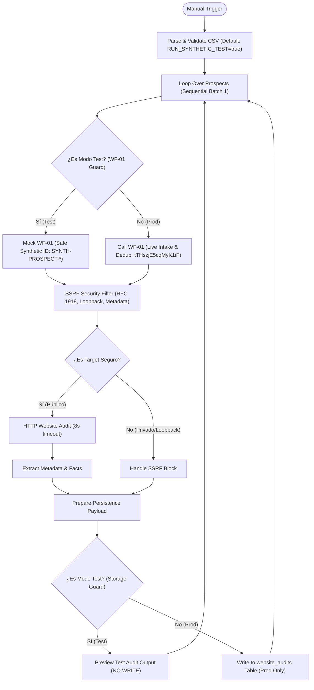

# Arquitectura ZYRVAE WF-02 — CSV Lead Import & Website Audit

## 1. Resumen Ejecutivo y Objetivo
El workflow **ZYRVAE WF-02** automatiza la ingesta de prospectos mediante CSV, orquesta la validación y deduplicación a través de **ZYRVAE WF-01**, ejecuta auditorías HTTP no invasivas sobre los sitios web de los prospectos válidos y estructura evidencias técnicas objetivas para identificar hipótesis comerciales concretas.

* **Estado de activación:** `active: false` (Inactivo por diseño).
* **ID de Integración con WF-01:** `tTHszjE5cqMyK1iF` (`ZYRVAE WF-01 Lead Intake & Data Quality`).
* **Tabla de persistencia de destino:** `website_audits` (relacionada 1:N con `prospects.id`).
* **Modo de Seguridad Predeterminado:** `RUN_SYNTHETIC_TEST = true` (Aislamiento absoluto con bypass de WF-01 y almacenamiento en modo prueba).

---

## 2. Diagrama de Flujo con Aislamiento de Seguridad (Bypass Guards)

---

## 3. Especificación Detallada de Nodos

| Nodo | Tipo de Nodo | Propósito y Aislamiento de Seguridad |
| :--- | :--- | :--- |
| **Manual Trigger** | `n8n-nodes-base.manualTrigger` | Inicio manual / testeo en n8n UI. |
| **Parse & Validate CSV** | `n8n-nodes-base.code` | Variable `RUN_SYNTHETIC_TEST = true` por defecto. Si es test, inyecta 6 casos sintéticos con `is_synthetic_test: true`. Si es false, exige archivo binario real. |
| **Loop Over Prospects** | `n8n-nodes-base.splitInBatches` | Tamaño de lote 1 (`batchSize: 1`) para garantizar procesamiento secuencial estricto. |
| **Is Test Mode? (WF-01 Guard)** | `n8n-nodes-base.if` | Bifurca según `is_synthetic_test === true`. Impide que datos de prueba alcancen a WF-01. |
| **Mock WF-01 (Safe Synthetic)** | `n8n-nodes-base.code` | Genera un ID sintético `SYNTH-PROSPECT-{row}-{timestamp}-TESTONLY` sin invocar a WF-01 ni escribir en `prospects`. |
| **Call WF-01 (Live Intake)** | `n8n-nodes-base.executeWorkflow` | Invoca a WF-01 (`tTHszjE5cqMyK1iF`) **únicamente** cuando `is_synthetic_test === false`. |
| **SSRF Security Filter** | `n8n-nodes-base.code` | **Obligatorio en ambas ramas**. Bloquea loopback (`127.0.0.1`, `::1`), privadas (`10.x`, `172.16-31.x`, `192.168.x`) y cloud metadata (`169.254.169.254`). |
| **Is Target Safe?** | `n8n-nodes-base.if` | Desvía URLs privadas a `Handle SSRF Block` sin emitir peticiones HTTP. |
| **HTTP Website Audit** | `n8n-nodes-base.httpRequest` | Timeout 8.000 ms, máx. 5 redirecciones, headers corporativos estándar, `neverError: true`. |
| **Extract Metadata & Facts** | `n8n-nodes-base.code` | Extracción HTML de Title, Meta Description, Viewport, SSL y categorización de hipótesis comerciales. |
| **Handle SSRF Block** | `n8n-nodes-base.code` | Registro de evidencia de bloqueo por SSRF sin llamada de red. |
| **Prepare Persistence Payload** | `n8n-nodes-base.code` | Mapeo al esquema estandarizado de `website_audits` con ID sintético `SYNTH-AUDIT-*` si es prueba. |
| **Is Test Mode? (Storage Guard)** | `n8n-nodes-base.if` | Bifurca según `is_synthetic_test === true`. Impide cualquier escritura en Data Tables durante la prueba. |
| **Preview Test Audit (No Write)** | `n8n-nodes-base.code` | Terminal de prueba: expone el JSON completo en el panel de n8n para inspección con `_storage_status: 'DRY_RUN_NO_DATABASE_WRITE_PERFORMED'`. |
| **Write to website_audits Table** | `n8n-nodes-base.code` | Terminal de producción: destino final de persistencia real en la Data Table `website_audits`. |

---

## 4. Garantías de Seguridad y Verificación Topológica

El test automatizado [`tests/test_workflow_topology.py`](file:///home/runner/work/my-project-4/my-project-4/tests/test_workflow_topology.py) verifica formalmente:
1. **0 caminos entre la rama sintética y WF-01:** La salida de prueba se conecta exclusivamente a `Mock WF-01`.
2. **0 caminos entre la rama sintética y escrituras en tablas:** La salida de prueba se conecta exclusivamente a `Preview Test Audit (No Write)`.
3. **Paso forzoso por el filtro SSRF:** Ninguna URL puede alcanzar `HTTP Website Audit` sin haber sido validada por `SSRF Security Filter`.
4. **No reutilización de identificadores:** Los IDs sintéticos incorporan timestamp de alta resolución y sufijo explícito `-TESTONLY`.
