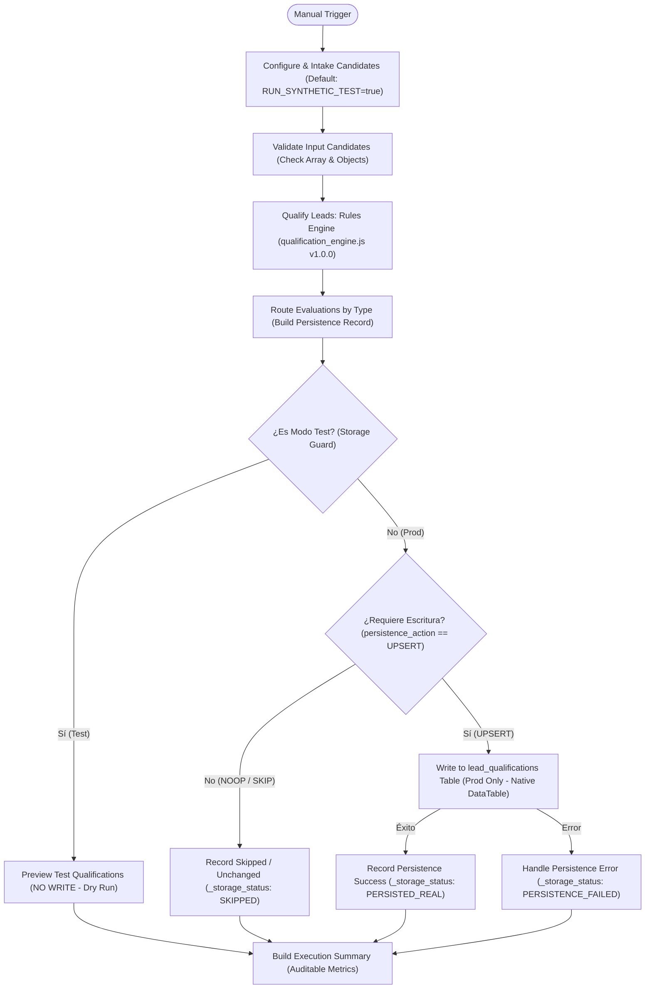

# Arquitectura ZYRVAE WF-03 — Lead Qualification & Prioritization

## 1. Resumen Ejecutivo y Objetivo
El workflow **ZYRVAE WF-03** automatiza la calificación comercial y priorización de prospectos a partir de evidencias técnicas objetivas generadas por **WF-02** (`website_audits`) y datos de prospectos saneados por **WF-01** (`prospects`).

El objetivo es establecer un sistema de scoring **determinista, auditable, explicable y configurable**, que transforme señales técnicas verificadas (como ausencia de SSL, diseño no responsivo o lentitud) en niveles de prioridad comercial concretos (**Alta**, **Media**, **Baja**), excluyendo rigurosamente los datos de prueba y derivando a **Revisión Manual** cualquier registro con evidencia insuficiente, trazabilidad desconocida o contradicciones técnicas.

* **ID en n8n:** Preparado para importación / vinculación (`active: false` por diseño).
* **Modo de Seguridad Predeterminado:** `RUN_SYNTHETIC_TEST = true` (Aislamiento absoluto con cero escrituras y lote de prueba sintético incorporado).
* **Fuentes de entrada:**
  * Tabla `prospects` (`XXFhpG7YA3LLc0F4`, generada por WF-01).
  * Tabla `website_audits` (`dpLz1QDQU3l4GyrP`, generada por WF-02).
* **Tabla de persistencia de destino:** `lead_qualifications` (definida en `sql/003_create_lead_qualifications_table.sql`).
* **Motor de Reglas:** `scripts/wf03/qualification_engine.js` (v1.0.0, función pura determinista).

---

## 2. Diagrama de Flujo con Aislamiento de Seguridad y Persistencia



---

## 3. Especificación Detallada de Nodos de WF-03

| Nodo | Tipo de Nodo | Propósito y Aislamiento |
| :--- | :--- | :--- |
| **Manual Trigger** | `n8n-nodes-base.manualTrigger` | Disparo manual o invocación programada. Inactivo en producción por defecto. |
| **Configure & Intake Candidates** | `n8n-nodes-base.code` | Variable `RUN_SYNTHETIC_TEST = true` obligatoria por defecto. Si es test, inyecta 8 casos sintéticos borde con `is_synthetic_test: true`. Si es false, recibe los arrays reales de `prospects` y `website_audits`. |
| **Validate Input Candidates** | `n8n-nodes-base.code` | Separa errores recuperables de fatales. Comprueba que las entradas sean arrays, valida que cada elemento posea `lead_key` canónico no vacío y descarta filas vacías o malformadas. |
| **Qualify Leads (Rules Engine)** | `n8n-nodes-base.code` | **Núcleo algorítmico**. Embebe directamente `scripts/wf03/qualification_engine.js`. Evalúa lote completo determinísticamente mediante `wf03QualifyBatch()`. |
| **Route Evaluations by Type** | `n8n-nodes-base.code` | Desempaqueta las evaluaciones individuales, ejecuta `wf03BuildPersistenceRecord` y `wf03ValidatePersistenceRecord`, preparando el payload exacto de persistencia. |
| **Is Test Mode? (Storage Guard)** | `n8n-nodes-base.if` | Bifurcación de seguridad según `is_synthetic_run === true`. Impide de forma absoluta cualquier escritura en tablas durante pruebas o ejecuciones sintéticas. |
| **Preview Test Qualifications (No Write)** | `n8n-nodes-base.code` | Terminal de prueba aislada: expone el JSON completo con `_storage_status: 'DRY_RUN_NO_DATABASE_WRITE_PERFORMED'`. |
| **Filter Valid Persistable Records** | `n8n-nodes-base.if` | Comprueba `persistence_action === 'UPSERT'`. Registros sin cambios (`NOOP_UNCHANGED`) o datos de prueba omitidos (`SKIP_TEST_DATA`) evitan escrituras redundantes. |
| **Record Skipped / Unchanged** | `n8n-nodes-base.code` | Registra `_storage_status: 'SKIPPED_IDEMPOTENT_OR_TEST_DATA'`. |
| **Write to lead_qualifications Table (Prod Only)** | `n8n-nodes-base.dataTable` | Inserción o actualización (`upsert`) en la tabla `lead_qualifications` filtrando por `qualification_id`. Configurado con `onError: continueErrorOutput`. |
| **Record Persistence Success** | `n8n-nodes-base.code` | Registra `_storage_status: 'PERSISTED_REAL'`. |
| **Handle Persistence Error** | `n8n-nodes-base.code` | Captura el error exacto de la base de datos o tabla, registra `_storage_status: 'PERSISTENCE_FAILED'`. **Garantiza que un fallo de persistencia nunca sea informado como éxito.** |
| **Build Execution Summary** | `n8n-nodes-base.code` | Consolida métricas del lote: total evaluados, prioridades alta/media/baja, pendientes de revisión, excluidos de prueba, persistidos, omitidos y fallos. |

---

## 4. Contratos Reales de Integración (Entrada WF-01 / WF-02 y Salida WF-03)

### Contrato de Entrada desde WF-01 (`prospects`)
* `lead_key` (String, Requerido): Identificador deduplicado canónico.
* `business_name` (String, Opcional): Nombre comercial.
* `website_url` (String, Requerido): URL del sitio web.
* `status` (String, Requerido): Estado del prospecto (debe ser `'validated'`).
* `is_test_data` (Boolean Nullable, Tri-estado): `true` (test), `false` (real confirmado), `null` (desconocido).
* `traceability_status` (String): `'CONFIRMED_REAL'`, `'TEST_DATA'`, `'UNKNOWN_TRACEABILITY'`.
* `country` (String, Opcional): País de operación.
* `industry` (String, Opcional): Sector o industria.

### Contrato de Entrada desde WF-02 (`website_audits`)
* `audit_id` (String, Requerido): Clave determinista de la auditoría (`aud_<hash>`).
* `lead_key` / `prospect_id` (String, Requerido): Clave del prospecto asociado.
* `audit_date` (Date / ISO String, Requerido): Fecha de realización de la auditoría.
* `initial_url` y `final_url` (String): URLs auditadas.
* `is_accessible` (Boolean, Requerido): `true` si respondió con status 2xx/3xx.
* `http_status` (Number): Código HTTP.
* `ssl_active` (Boolean): Flag de HTTPS activo.
* `has_viewport` (Boolean): Flag de etiqueta viewport encontrada.
* `response_time_ms` (Number): Tiempo de respuesta en milisegundos.
* `raw_evidence` (JSON String, Requerido): Metadatos detallados de análisis, incluyendo `analysis_verifiable` y `feature_status` (`viewport`, `meta_description`, `page_title`).
* `commercial_hypotheses` (JSON String): Hipótesis generadas por WF-02.
* `is_test_data` (Boolean Nullable) e `is_synthetic_test` (Boolean).

### Contrato de Salida de WF-03 (`lead_qualifications`)
* `qualification_id` (String, Clave primaria): `lq_<fingerprint>` en producción o `SYNTH-LQ-<fingerprint>-TESTONLY` en modo test.
* `lead_key` (String): Referencia al prospecto.
* `score` (Number 0-100 o `null`): Puntuación calculada.
* `classification` (String): `PRIORITY_HIGH`, `PRIORITY_MEDIUM`, `PRIORITY_LOW`, `REVIEW_REQUIRED`, `EXCLUDED_TEST_DATA`.
* `priority_label` (String): Etiqueta legible en español.
* `traceability_status` (String): Estado formal de trazabilidad.
* `requires_review` (Boolean): `true` si requiere revisión manual humana.
* `review_reasons` (JSON String): Array de códigos y detalles de revisión.
* `verified_findings` (JSON String): Hallazgos técnicos comprobados en la auditoría.
* `score_components` (JSON String): Desglose transparente de puntos por componente.
* `caps_applied` (JSON String): Topes impuestos y si resultaron vinculantes.
* `commercial_use_allowed` (Boolean): `true` **únicamente** si es comercial válida, trazabilidad `CONFIRMED_REAL` y modo no sintético.
* `evidence_fingerprint` (String): Hash FNV-1a de toda la evidencia evaluada.
* `supersedes_qualification_id` (String): ID de la calificación previa reemplazada.

---

## 5. Política Estricta de Trazabilidad

En cumplimiento de los principios innegociables del proyecto:
1. **`is_test_data = true` o `is_synthetic_test = true`:**
   * Clasificación obligatoria: `EXCLUDED_TEST_DATA`.
   * Puntuación: `null` (sin scoring comercial).
   * `commercial_use_allowed = false`.
2. **`traceability_status = UNKNOWN_TRACEABILITY`:**
   * Clasificación obligatoria: `REVIEW_REQUIRED`.
   * Puntuación: `null`.
   * `commercial_use_allowed = false`.
   * **Nunca se asume como prospecto real confirmado.**
3. **Ausencia de marca (`is_test_data = null` o ausente):**
   * Se asigna `UNKNOWN_TRACEABILITY` y motivo `TRACEABILITY_UNCONFIRMED`.
   * No se convierte a `false` ni se asume producción.
4. **Señales contradictorias o patrones sospechosos:**
   * Señales simultáneas de test y real, o uso de dominios de prueba (`example.com`, `example.org`, etc.) con marca real generan `CONTRADICTORY_TRACEABILITY` y se envían a `REVIEW_REQUIRED`.
5. **Solo registros con trazabilidad real explícitamente confirmada (`CONFIRMED_REAL`)** pueden recibir puntuación comercial y tener `commercial_use_allowed = true`.

---

## 6. Reglas de Calificación, Scoring y Umbrales (Reglas v1.0.0)

### 6.1. Rango y Distribución de Puntos (0 a 100)
El score total es la suma acotada de cuatro componentes deterministas:

$$\text{Score} = \min(100, \max(0, \text{Técnico} + \text{Evidencia} + \text{Servicios} + \text{Completitud}))$$

1. **Componente Técnico (Máximo 40 puntos):**
   * `NO_HTTPS` (+15 pts): El sitio se sirve por HTTP sin cifrar (servicio `WEB_SECURITY_SSL`).
   * `NO_VIEWPORT` (+15 pts): Ausencia comprobada de `<meta name="viewport">` (`MOBILE_RESPONSIVE_UX`).
   * `NO_META_DESCRIPTION` (+8 pts): Ausencia comprobada de meta description (`SEO_ONPAGE`).
   * `NO_TITLE` (+7 pts): Ausencia comprobada de `<title>` (`SEO_ONPAGE`).
   * `SLOW_RESPONSE` (+5 pts): Tiempo de respuesta medido $> 3.000\text{ ms}$ (`WEB_PERFORMANCE`).
   * *Tope estricto:* Si la suma técnica supera 40 puntos, se aplica `TECHNICAL_CAP` para no inflar la puntuación artificialmente.

2. **Calidad y Frescura de Evidencia (Máximo 30 puntos):**
   * *Verificabilidad HTML:* Análisis completo (+15 pts) vs Análisis parcial (+8 pts).
   * *Frescura:* Auditoría fresca $\le 30$ días (+10 pts), reciente $\le 90$ días (+5 pts), envejecida $\le 180$ días (+0 pts). Mayor a 180 días se envía a revisión (`AUDIT_STALE`).
   * *Coherencia:* Sin inconsistencias entre campos (+5 pts).

3. **Encaje con Servicios Confirmados de ZYRVAE (Máximo 20 puntos):**
   * 2 o más servicios confirmados con hallazgos: +20 pts.
   * 1 servicio confirmado con hallazgos: +12 pts.
   * 0 servicios confirmados: +0 pts.
   * *Nota:* Por prudencia, los servicios en `service_catalog` tienen `confirmed: false` por defecto hasta ser explícitamente confirmados por la dirección de ZYRVAE.

4. **Completitud de Información del Prospecto (Máximo 10 puntos):**
   * `business_name` presente: +3 pts.
   * `website_url` presente y válido: +3 pts.
   * `country` presente: +2 pts.
   * `industry` presente: +2 pts.

### 6.2. Umbrales de Clasificación
* **Prioridad Alta (`PRIORITY_HIGH`):** $\ge 70$ puntos.
* **Prioridad Media (`PRIORITY_MEDIUM`):** $45 - 69$ puntos.
* **Prioridad Baja (`PRIORITY_LOW`):** $< 45$ puntos.

### 6.3. Topes de Seguridad (Caps)
Incluso con score $\ge 70$, un prospecto queda topado a `PRIORITY_MEDIUM` si:
* La auditoría es parcial (`PARTIAL_AUDIT`).
* La auditoría tiene entre 91 y 180 días (`AUDIT_AGING`).
* Hay inconsistencias menores en la evidencia (`MINOR_INCONSISTENCY`).
* WF-02 emitió hipótesis comerciales no respaldadas por hallazgos verificados (`UNSUPPORTED_HYPOTHESES`).
* No existen servicios confirmados de ZYRVAE coincidentes (`SERVICE_FIT_UNCONFIRMED`).

### 6.4. Separación Comercial y Prudencia
* Un sitio inaccesible **nunca** se interpreta como mala calidad del sitio ni se puntúa: se envía a revisión para reauditoría (`SITE_UNREACHABLE_REAUDIT`).
* WF-03 mide oportunidad técnica verificada; no infiere intención de compra, presupuesto, urgencia ni autoridad de decisión (`commercial_signals`).

---

## 7. Persistencia Idempotente y Esquema de `lead_qualifications`

### Clave de Idempotencia y Huella Digital
La clave `qualification_id` se calcula determinísticamente:
$$\text{fingerprint} = \text{FNV-1a}(\text{rules\_version} + \text{rules\_digest} + \text{lead\_key} + \text{input\_snapshot} + \text{outcome\_digest})$$
* En producción: `lq_<fingerprint>`
* En modo sintético: `SYNTH-LQ-<fingerprint>-TESTONLY`

### Comportamiento de Reejecución
* **Mismo prospecto con misma evidencia:** `persistence_action = 'NOOP_UNCHANGED'`. No escribe ni altera datos históricos.
* **Mismo prospecto con nueva evidencia (reauditoría):** `persistence_action = 'UPSERT'`, vinculando `supersedes_qualification_id` al ID anterior para trazabilidad no destructiva.
* **Datos de prueba:** `persistence_action = 'SKIP_TEST_DATA'` o `PREVIEW_ONLY`.

### Esquema de la Tabla (DDL)
Definido en [`sql/003_create_lead_qualifications_table.sql`](file:///home/runner/work/my-project-4/my-project-4/sql/003_create_lead_qualifications_table.sql). Contiene 34 columnas compatibles con n8n Data Tables y PostgreSQL / Supabase, con índices optimizados en `qualification_id`, `lead_key`, `classification`, `score` y `traceability_status`.

---

## 8. Manejo de Errores y Resumen de Ejecución

1. **Errores de Entrada:** Se capturan en `input_errors` sin interrumpir la evaluación del resto del lote.
2. **Errores de Persistencia:** El nodo `dataTable` opera con `onError: continueErrorOutput`. Los fallos se derivan a `Handle Persistence Error` con `_storage_status: 'PERSISTENCE_FAILED'`.
3. **Resumen Final:** El nodo `Build Execution Summary` audita el conteo de registros y cambia el estado del workflow a `COMPLETED_WITH_STORAGE_FAILURES` si hubo fallos de almacenamiento, impidiendo falsos positivos.

---

## 9. Variables de Configuración y Entorno

* `RUN_SYNTHETIC_TEST` (Boolean): En el nodo `Configure & Intake Candidates`. `true` por defecto para aislamiento.
* `confirmed_service_codes` (Array de strings): Códigos de servicios comercialmente confirmados por ZYRVAE (ej. `['WEB_SECURITY_SSL']`).
* `audit_unknown_traceability_policy`: `'REVIEW'` (por defecto, política estricta).
* `persist_excluded_test_data`: `false` (por defecto, no persiste datos sintéticos en tablas de producción).

---

## 10. Ejecución de Tests y Verificación

La suite de pruebas automatizadas cubre el 100% de los 18 escenarios obligatorios:
* **Suite Node.js:**
  ```bash
  node scripts/wf03/test_qualification_engine.js
  ```
* **Suite Python (Integración de repositorio):**
  ```bash
  python3 -m unittest discover -s tests -p "test_*.py"
  ```
* **Generación del Workflow:**
  ```bash
  node scripts/wf03/build_workflow.js
  ```

---

## 11. Estado de Sincronización y Configuración Pendiente

* **Workflows en n8n Cloud:**
  * WF-01 (`tTHszjE5cqMyK1iF`): `active: false` (Preservado e inactivo).
  * WF-02 (`KosNnbUlKPeKZXHh`): `active: false` (Preservado e inactivo).
  * WF-03 (`ZYRVAE_WF-03_Lead_Qualification_Prioritization.json`): Generado localmente con `active: false`. Pendiente de importación controlada a n8n Cloud cuando se autorice su despliegue.
* **Data Table `lead_qualifications`:**
  * Estructura DDL completamente documentada en `sql/003_create_lead_qualifications_table.sql`.
  * Pendiente de creación en n8n Cloud (respetando la restricción de no crear recursos de producción sin autorización previa).
