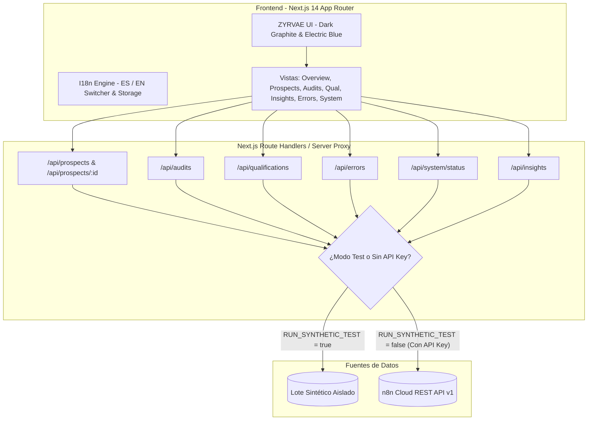

# ZYRVAE Intelligence Dashboard — Arquitectura Técnica y Manual de Operaciones

**Versión:** 1.0.0  
**Producto:** Centro Interno de Inteligencia Comercial & Operaciones  
**Organización:** ZYRVAE Digital Studio  
**Entorno de Despliegue:** Vercel (Next.js 14 App Router)  
**Automatización y Backend:** n8n Cloud (`https://zyrvae.app.n8n.cloud`)  

---

## 1. Resumen Ejecutivo y Alcance

**ZYRVAE Intelligence Dashboard** es la plataforma interna de control, diagnóstico y visualización de oportunidades comerciales de ZYRVAE Digital Studio. Centraliza y procesa los datos producidos por la suite de automatizaciones de prospección:

* **WF-01 Lead Intake & Data Quality (`tTHszjE5cqMyK1iF`):** Normalización, deduplicación y almacenamiento en la Data Table `prospects` (`XXFhpG7YA3LLc0F4`) y `lead_intake_errors` (`Qig4adosI9vsNThw`).
* **WF-02 CSV Lead Import & Website Audit (`KosNnbUlKPeKZXHh`):** Auditoría técnica HTTP no invasiva con control SSRF y almacenamiento en `website_audits` (`dpLz1QDQU3l4GyrP`).
* **WF-03 Lead Qualification & Prioritization (`O4YiErQMAGK9yGPZ`):** Motor de reglas determinista de scoring (0-100), trazabilidad tri-estado y persistencia en `lead_qualifications` (`GTtrgRiV4XxZijZZ`).

### Principios Fundamentales de la Versión 1.0
1. **Modo Estrictamente de Consulta (Read-Only):** Cero operaciones de escritura hacia n8n o bases de datos productivas.
2. **Workflows Inactivos por Seguridad:** WF-01, WF-02 y WF-03 permanecen configurados como `active: false` hasta la autorización comercial explícita.
3. **Aislamiento Sintético Riguroso (`RUN_SYNTHETIC_TEST = true`):** El entorno de prueba utiliza un lote de demostración enriquecido sin mezclar datos sintéticos y reales.
4. **Separación Comercial y Técnica:** WF-03 evalúa exclusivamente oportunidades técnicas comprobadas, sin inferir intención de compra, presupuesto o autoridad.
5. **Seguridad de Credenciales:** La API key de n8n Cloud reside exclusivamente en variables de entorno server-side, sin exponerse en el bundle público.

---

## 2. Arquitectura de la Solución



---

## 3. Estructura de Directorios

```
my-project-4/
├── docs/
│   ├── ARCHITECTURE_WF-02.md       # Especificación técnica de WF-02
│   ├── ARCHITECTURE_WF-03.md       # Especificación técnica de WF-03
│   └── DASHBOARD_ARCHITECTURE.md    # Documento de arquitectura del dashboard
├── scripts/
│   ├── audit_engine.py             # Motor de validación y auditoría HTTP
│   └── wf03/
│       ├── qualification_engine.js # Motor determinista de calificación WF-03
│       ├── build_workflow.js       # Compilador de n8n WF-03
│       └── test_qualification_engine.js # Suite unitaria de WF-03
├── sql/
│   ├── 002_create_website_audits_table.sql
│   └── 003_create_lead_qualifications_table.sql
├── src/
│   ├── app/                        # Next.js App Router
│   │   ├── api/                    # Route Handlers del backend seguro
│   │   │   ├── audits/route.ts
│   │   │   ├── errors/route.ts
│   │   │   ├── insights/route.ts
│   │   │   ├── overview/route.ts
│   │   │   ├── prospects/
│   │   │   │   ├── [id]/route.ts
│   │   │   │   └── route.ts
│   │   │   ├── qualifications/route.ts
│   │   │   └── system/status/route.ts
│   │   ├── audits/page.tsx         # 04 — Website Audits
│   │   ├── errors/page.tsx         # 07 — Errors & Logs
│   │   ├── insights/page.tsx       # 06 — Insights & Patrones
│   │   ├── overview/page.tsx       # 01 — Overview principal
│   │   ├── prospects/              # 02 & 03 — Prospects & Prospect Detail
│   │   │   ├── [id]/page.tsx
│   │   │   └── page.tsx
│   │   ├── qualification/page.tsx  # 05 — Qualification WF-03
│   │   ├── system/page.tsx         # 08 — System Status
│   │   ├── globals.css
│   │   ├── layout.tsx
│   │   └── page.tsx
│   ├── components/                 # Componentes reutilizables
│   │   ├── layout/                 # AppShell, Sidebar, Header
│   │   └── ui/                     # Badge, Card, MetricCard, EmptyState, SearchInput, etc.
│   ├── lib/
│   │   ├── data-service.ts         # Orquestador de datos y relaciones de tablas
│   │   ├── i18n/                   # Contexto de idiomas ES / EN y diccionarios
│   │   ├── n8n-client.ts           # Cliente HTTP server-side para n8n Cloud
│   │   └── synthetic-data.ts       # Lote sintético completo y riguroso
│   └── types/                      # Interfaces TypeScript
│       ├── audit.ts
│       ├── error-log.ts
│       ├── prospect.ts
│       ├── qualification.ts
│       └── system.ts
├── tests/                          # Suites unitarias y de integración
├── workflows/                      # Definiciones exportadas para n8n
├── .env.example                    # Plantilla de variables de entorno
├── next.config.mjs                 # Configuración de Next.js
├── tailwind.config.ts              # Paleta editorial grafito oscuro y azul eléctrico
├── tsconfig.json
└── vercel.json                     # Cabeceras de seguridad para Vercel
```

---

## 4. Rutas Disponibles

| Ruta | Nombre del Módulo | Función Principal |
| :--- | :--- | :--- |
| `/overview` | 01 — Overview | Métricas clave consolidadas, distribución de prioridades y actividad reciente. |
| `/prospects` | 02 — Prospects | Directorio de prospectos con búsqueda, filtros, ordenamiento y paginación. |
| `/prospects/[id]` | 03 — Prospect Detail | Ficha técnica de 10 secciones: ingesta, normalización, web, auditoría, calificación, etc. |
| `/audits` | 04 — Website Audits | Consulta técnica de auditorías HTTP con severidad de hallazgos e inspector JSON. |
| `/qualification` | 05 — Qualification | Evaluaciones de WF-03, desglose de scoring (0-100), topes y aviso de alcance comercial. |
| `/insights` | 06 — Insights | Tendencias de problemas frecuentes, distribución de hipótesis y estado web. |
| `/errors` | 07 — Errors & Logs | Registro centralizado de diagnósticos de intake, auditoría y procesamiento (Read-Only). |
| `/system` | 08 — System Status | Monitor de salud de n8n Cloud, checklist de variables y verificación de workflows inactivos. |

---

## 5. Esquemas de Datos y Relaciones

El sistema unifica cuatro tablas mediante la clave canónica **`lead_key`**:

1. **`prospects` (`XXFhpG7YA3LLc0F4`):**
   * Clave primaria: `id`. Clave canónica: `lead_key`.
   * Atributos: `business_name`, `website_url`, `country`, `industry`, `status`, `traceability_status`, `requires_review`.
2. **`website_audits` (`dpLz1QDQU3l4GyrP`):**
   * Clave primaria: `audit_id`. Clave foránea: `lead_key` / `prospect_id`.
   * Atributos: `audit_date`, `initial_url`, `final_url`, `http_status`, `redirect_count`, `response_time_ms`, `ssl_active`, `has_viewport`, `commercial_hypotheses`, `raw_evidence`.
3. **`lead_qualifications` (`GTtrgRiV4XxZijZZ`):**
   * Clave primaria: `qualification_id` (`lq_<fingerprint>`). Clave foránea: `lead_key`, `primary_audit_id`.
   * Atributos: `classification`, `score`, `score_components`, `caps_applied`, `commercial_use_allowed`, `review_reasons`, `verified_findings`, `explanation`.
4. **`lead_intake_errors` (`Qig4adosI9vsNThw`):**
   * Atributos: `timestamp`, `workflow`, `lead_key`, `error_type`, `error_message`, `raw_payload`, `status`.

---

## 6. Variables de Entorno y Despliegue en Vercel

### Archivo `.env.example`
```bash
# n8n Cloud Instance Configuration (Server-side ONLY)
N8N_BASE_URL=https://zyrvae.app.n8n.cloud
N8N_API_KEY=

# Identificadores de Workflows
N8N_PROJECT_ID=gpI1QfU4f7fk1cv8
N8N_WF01_ID=tTHszjE5cqMyK1iF
N8N_WF02_ID=KosNnbUlKPeKZXHh
N8N_WF03_ID=O4YiErQMAGK9yGPZ

# Identificadores de Data Tables
N8N_TABLE_PROSPECTS=XXFhpG7YA3LLc0F4
N8N_TABLE_AUDITS=dpLz1QDQU3l4GyrP
N8N_TABLE_QUALIFICATIONS=GTtrgRiV4XxZijZZ
N8N_TABLE_ERRORS=Qig4adosI9vsNThw

# Modo de Seguridad (true = Aislamiento Sintético, false = Producción en Vivo)
RUN_SYNTHETIC_TEST=true
```

### Configuración en Vercel:
1. Acceder al dashboard de Vercel en el proyecto conectado.
2. Navegar a **Project Settings** → **Environment Variables**.
3. Cargar las variables anteriores para los entornos de **Production** y **Preview**.
4. La variable `N8N_API_KEY` nunca debe contener el prefijo `NEXT_PUBLIC_` para garantizar que no sea accesible desde el navegador del cliente.

---

## 7. Instrucciones Locales

### Instalación de dependencias:
```bash
npm install
```

### Ejecución de pruebas integrales:
```bash
npm run test
```
Ejecuta la suite Node.js de 18 escenarios de WF-03 y los 42 tests de Python.

### Verificación de Lint:
```bash
npm run lint
```

### Compilación y Build:
```bash
npm run build
```

### Servidor de desarrollo:
```bash
npm run dev
```

---

## 8. Limitaciones Conocidas y Evolución Futura

* **Scoring Técnico Exclusivo:** El motor WF-03 evalúa la oportunidad técnica de optimización detectada en el sitio web; no infiere interés comercial, presupuesto ni capacidad de decisión de la contraparte.
* **Modo Consulta:** La versión 1.0 no implementa acciones de reintento automático ni edición de prospectos para prevenir alteraciones accidentales en tablas reales.
* **Evolución Futura:** La arquitectura modular por capas permite incorporar posteriormente gestión de contactos comerciales (WF-04), cotizaciones automatizadas, análisis histórico comparativo de auditorías y capacidades multi-inquilino.
